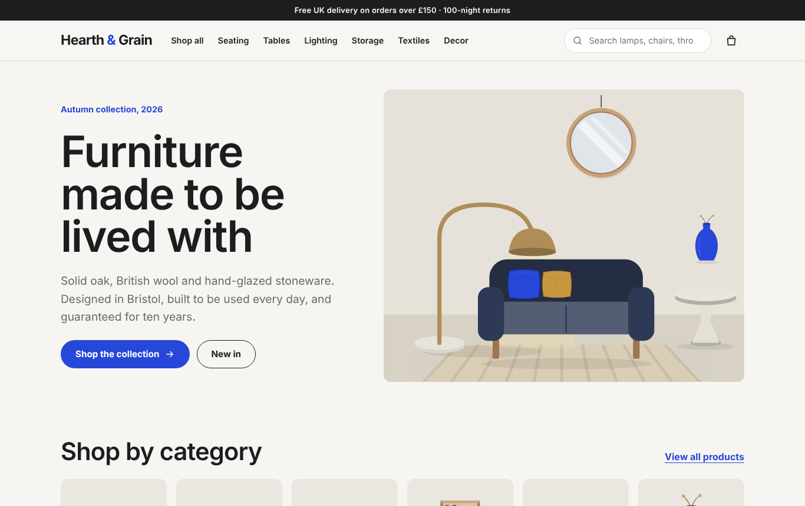

# Hearth & Grain: Furniture & Homeware Store

An e-commerce front end for **Hearth & Grain**, a fictional furniture and homeware brand. It's built with React, React Router and Vite.

**Live demo:** _add your Netlify/Vercel link here_
**Built by:** _Molly Hoy_



## Features

- **7 routes** with React Router: home, shop, product detail (`/product/:slug`), basket, checkout, order confirmation and a 404 page
- **Search, filter and sort** by category, maximum price (custom range slider), stock and sale status. The search box matches names, materials and colours, and there are five sort orders.
  - Filters are stored in the URL (`/shop?category=lighting&sort=price-asc`), so views can be bookmarked and shared, and the Back button undoes a change.
  - Active filters appear as removable chips, with a live result count and an empty state.
- **Shopping basket** built with React Context and `useReducer`:
  - add, update and remove items, limited to the stock available
  - a slide-out drawer with a progress bar towards free delivery
  - saved to `localStorage`, so it survives a page refresh
- **Live colour switching**: every product is an SVG illustration that redraws in the chosen colour
- **Checkout** with React-controlled validation (email, UK postcode and required fields), a GOV.UK-style error summary, delivery options that update the total, and a confirmation page
- **Accessibility**: the drawer and filter panel are accessible modals (focus trap, Escape to close, focus restored). The site also uses ARIA live regions, labelled controls, `aria-pressed`/`aria-current` states and visible focus rings, and supports `prefers-reduced-motion`.
- **Responsive** from 320px to desktop: filters become a slide-in panel on small screens, and the header becomes a menu panel

## Tech

React 19 · React Router 7 · Vite · CSS Modules · JSON data

## Getting started

[Node.js](https://nodejs.org) (version 20 or newer).

```bash
npm install      # download React, React Router and Vite (first time only)
npm run dev      # start the development server at http://localhost:5173
npm run build    # create an optimised version in /dist, ready to host
```

## Project structure

```
src/
├── main.jsx               App entry: router + basket provider
├── App.jsx                Layout and the list of routes
├── context/
│   └── CartContext.jsx    Basket state (useReducer + Context + localStorage)
├── data/
│   ├── products.json      21 products: prices, colours, stock, dimensions
│   └── categories.js
├── components/            Reusable pieces: Header, ProductCard, CartDrawer,
│                          ProductArt (SVG drawings), QuantityControl, ...
├── pages/                 One file per route
├── styles/global.css      Design tokens, reset, buttons, form fields
└── utils/format.js        Price formatting, colour shading, delivery rules
```

## Deploying

Netlify: run `npm run build` and drag the `dist` folder onto Netlify, or connect the GitHub repo. The `public/_redirects` file makes sure links like `/product/kettle-stool` work when opened directly.

## What I'd add next

- Load products from an API instead of a JSON file, with loading and error states
- Product photos (add an `image` field to a product, and `ProductArt` will show it)
- Wishlist, product reviews and "recently viewed"
- Unit tests for the basket reducer with Vitest
